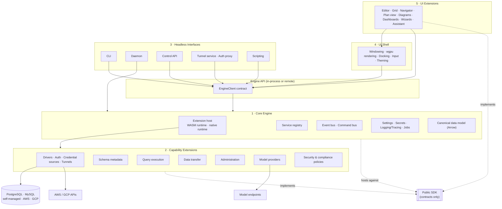
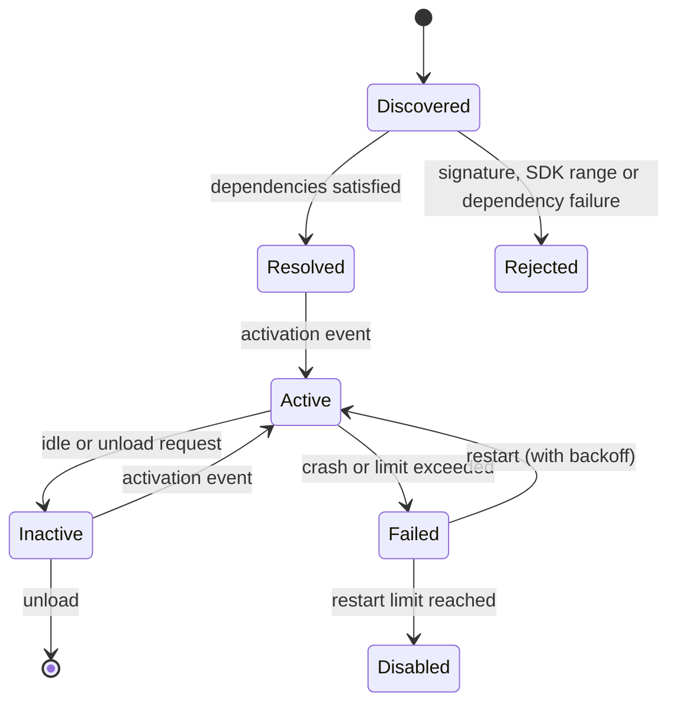
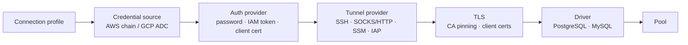

# Architecture

This document defines the core architecture of the database client described in [MISSION.md](MISSION.md). Constraints use the keywords MUST, MUST NOT, SHOULD and MAY as defined in RFC 2119 (see [§10](#10-architectural-governance)).

Decisions are recorded as ADRs in [`docs/adr/`](docs/adr/) and listed in [Decisions](#decisions).

## 1. Architectural Principles

| Principle | Constraint |
| --- | --- |
| Headless first | The core engine MUST operate without any UI. Layers 1–3 MUST ship as a complete product. |
| Extension first | Every functional capability MUST be implemented as an extension, including drivers, auth, export and UI views. |
| One public API | Built-in and third-party extensions MUST use the same public SDK. The core MUST NOT expose private hooks to built-in extensions. |
| Cloud-native auth | AWS and GCP IAM authentication and private connectivity MUST be first-class extension points, not driver special cases. |
| Local first | The product MUST work without accounts, telemetry or external services. Network calls happen only to user-configured databases, cloud APIs, model providers and extension registries. |
| Commercial neutrality | The core MUST NOT contain privileged APIs, licence checks or commercial logic. |
| Performance, security, efficiency | Each is a requirement with measurable targets ([§9](#9-quality-attributes)), not a later optimisation. |

## 2. System Architecture

### 2.1 Layers

| # | Layer | Responsibility | Ships in headless product |
| --- | --- | --- | --- |
| 1 | Core Engine | Runtime, extension host, service registry, event and command bus, core services (settings, secrets, logging, jobs), canonical data model | yes |
| 2 | Capability Extensions | Drivers, auth providers, credential sources, tunnels, metadata, execution, transfer, administration, model providers, security policies | yes |
| 3 | Headless Interfaces | CLI, daemon, control API, tunnel service, auth proxy, scripting host | yes |
| 4 | UI Shell | Windowing, rendering, layout, input, theming, platform services | no |
| 5 | UI Extensions | Editor, grid, navigator, diagrams, dashboards, wizards, assistant panel | no |

### 2.2 Component Diagram

### 2.3 Component Boundaries

| Component | Owns | Does not own |
| --- | --- | --- |
| Extension host | Loading, activation, isolation, permissions, lifecycle of extensions | Any database, cloud or format logic |
| Service registry | Lookup of typed, versioned services contributed by extensions | Service implementations |
| Event bus | Asynchronous publish/subscribe of typed events | Delivery guarantees beyond at-most-once per subscriber |
| Command bus | Named request/response commands with typed arguments | Command implementations |
| Core services | Settings, secret store access, logging/tracing, job scheduler | Policy decisions of capability extensions |
| Capability extensions | One capability each, behind an extension point contract | Process lifetime, UI, other extensions' internals |
| Engine API | The single contract that every interface and the UI uses to talk to the engine | Transport-specific behaviour (in-process call vs. remote call) |
| Headless interfaces | Translating user or machine input into Engine API calls | Business rules; these live in the engine and extensions |
| UI shell | Windows, rendering, layout, input, accessibility, platform services | Any data access; it MUST go through the Engine API |
| UI extensions | Views, panels and commands | Direct database or network access |

## 3. Dependency Rules

### 3.1 Crate Layout ([ADR-0009](docs/adr/0009-crate-layout.md))

| Crate | Layer | Content |
| --- | --- | --- |
| `rivet-sdk` | contract | Extension traits, WIT interfaces, manifest schema, canonical data types, error types |
| `rivet-engine-api` | contract | `EngineClient` contract and wire schema for the control API |
| `rivet-ui-sdk` | contract | UI extension points: views, panels, commands, keymaps |
| `rivet-core` | 1 | Extension host, registry, buses, core services |
| `rivet-ext-*` | 2 | One crate per capability extension (e.g. `rivet-ext-postgres`, `rivet-ext-aws-iam`) |
| `rivet-cli`, `rivet-daemon`, `rivet-proxy` | 3 | Headless interfaces and binaries |
| `rivet-ui-shell` | 4 | Windowing system |
| `rivet-ui-ext-*` | 5 | One crate per UI extension |
| `rivet-testkit` | test | Mock engine, database fixtures, extension test harness |

### 3.2 Permitted Dependencies

| From ↓ may depend on → | `rivet-sdk` | `rivet-engine-api` | `rivet-ui-sdk` | `rivet-core` | `rivet-ext-*` | `rivet-ui-shell` |
| --- | --- | --- | --- | --- | --- | --- |
| `rivet-sdk` | — | no | no | no | no | no |
| `rivet-engine-api` | yes | — | no | no | no | no |
| `rivet-ui-sdk` | yes | yes | — | no | no | no |
| `rivet-core` | yes | yes | no | — | **no** | no |
| `rivet-ext-*` | yes | no | no | **no** | **no** | no |
| `rivet-cli` / `-daemon` / `-proxy` | yes | yes | no | yes | no¹ | no |
| `rivet-ui-shell` | yes | yes | yes | no² | no | — |
| `rivet-ui-ext-*` | yes | yes | yes | no | no | no |
| `rivet-testkit`³ | yes | yes | no | yes | no | no |

¹ Binaries bundle built-in extensions as packaged artifacts loaded through the extension host, not as Rust dependencies.
² The in-process desktop build links `rivet-core` only in the binary crate that wires the `EngineClient`, never in `rivet-ui-shell` itself.
³ Proposed, [ADR-0016](docs/adr/0016-testkit-dependency-rule.md). A crate MAY depend on `rivet-testkit` only as a dev-dependency. `rivet-sdk`, `rivet-engine-api` and `rivet-core` MUST NOT depend on it in any kind. For all other pairs, the table applies to normal, build and dev dependencies alike.

### 3.3 Rules

- Dependencies MUST point downward or to a contract crate. Circular dependencies MUST NOT exist at crate or extension level.
- Public contracts (`rivet-sdk`, `rivet-engine-api`, `rivet-ui-sdk`) MUST NOT contain implementations beyond plain data types and helpers without I/O.
- `rivet-core` MUST NOT contain database-specific, dialect-specific or cloud-specific code. Such code lives only in capability extensions.
- Extensions MUST NOT depend on each other as crates. They interact only through the service registry, event bus and command bus.
- UI components MUST NOT open database, cloud or network connections. All data comes through the Engine API.
- Boundaries MUST be enforced in CI:
  - an `xtask check-arch` step validates the table in §3.2 against `cargo metadata` ([ADR-0010](docs/adr/0010-architecture-check.md));
  - `cargo-deny` checks licences, advisories and banned crates. Dependencies MUST have a permissive licence from the allow list in `deny.toml`; the project licence is not decided ([ADR-0012](docs/adr/0012-project-licence-open.md));
  - extension manifests are validated for undeclared dependencies.

## 4. Extension Architecture

### 4.1 Public SDK

- The SDK MUST be versioned with semver from v1. Breaking changes require a major version and the `breaking-change` label.
- All built-in features MUST compile against the published SDK only.
- The SDK ships in two bindings that describe the same contracts:
  - WIT interfaces for WASM components;
  - a stable C ABI header plus a Rust wrapper for native plugins.
- The WIT interfaces are delivered with the WASM runtime and the C ABI header with the native runtime. The WIT interface of an extension point is added with the first extension that uses it ([ADR-0013](docs/adr/0013-sdk-bindings-delivery.md)). Until then the Rust trait in `rivet-sdk` is the only definition of the contract.
- SDK documentation and examples are part of the SDK release.

### 4.2 Extension Points

| Extension point | Contract (summary) | Typical runtime |
| --- | --- | --- |
| Driver | Connect, execute, stream Arrow batches, cancel, describe dialect | native |
| Auth provider | Produce credentials (password, token, client cert) for a connection attempt; report expiry | WASM or native |
| Credential source | Resolve cloud identities (AWS default chain, GCP ADC), role assumption, impersonation | native |
| Tunnel / proxy provider | Open a byte stream to a target through SSH, SOCKS/HTTP, SSM or IAP | native |
| Metadata provider | Introspect catalog objects, generate DDL, compute diffs | WASM or native |
| Result sink | Consume an Arrow stream (grid, file, network) | WASM or native |
| Importer / exporter | Convert between Arrow streams and external formats | WASM |
| Model provider | Send a policy-filtered prompt, return a response | WASM |
| Script engine | Language adapter that runs scripts against the Engine API ([ADR-0007](docs/adr/0007-scripting-adapters.md)); Rhai is the first adapter | native |
| CLI command | Register a subcommand with typed arguments | WASM |
| API endpoint | Register a control API method | WASM |
| UI view / command / panel | Contribute UI elements (requires `requires_ui = true`) | WASM or native |

### 4.3 Execution Model and Isolation

| Runtime | Use | Isolation | Crash containment |
| --- | --- | --- | --- |
| WASM component on Wasmtime ([ADR-0002](docs/adr/0002-wasm-runtime.md)), default | All extensions unless they need native performance or OS access | Sandbox; host enforces permissions at every import | A trap stops only that instance; the host restarts it |
| Native plugin (C ABI) | Drivers, tunnels, credential sources, performance-critical code | Separate extension host process ([ADR-0003](docs/adr/0003-native-plugin-placement.md)) | Process crash is contained; the engine restarts the host process |

- A native plugin running in the engine process cannot be contained after memory corruption. Native plugins MUST therefore run in an out-of-process extension host by default. In-process native loading MAY be allowed only for signed first-party extensions where a benchmark shows the out-of-process cost is unacceptable ([ADR-0003](docs/adr/0003-native-plugin-placement.md)).
- Each extension MUST have resource limits: memory, CPU time per call (WASM fuel or epoch interruption), open handles, concurrent jobs.

### 4.4 Discovery, Activation and Lifecycle

- Extensions are discovered from: bundled packages, the user extension directory, the workspace extension directory and the registry.
- Each extension has a manifest named `extension.toml` ([ADR-0008](docs/adr/0008-manifest-and-secret-uris.md)) with:
  - id, version, SDK version range;
  - dependencies with semver ranges;
  - contributed extension points;
  - required capabilities (permissions);
  - activation events;
  - `requires_ui` flag.
- Activation MUST be lazy. Activation events include: first use of a contributed extension point, a command invocation, or opening a connection of a matching type.
- Extensions with `requires_ui = true` MUST NOT activate in a headless process.

- As built, the extension host differs from this diagram in two points ([ADR-0017](docs/adr/0017-extension-host-lifecycle.md), Proposed):
  - a failed activation is published as two changes, start state → `Active` → `Failed`;
  - an extension in `Resolved` or `Rejected` can be removed and discovered again.
- As built, if two discovery directories contain the same extension id, the later directory wins: bundled < user < workspace. ADR-0017 proposes to limit this when signature checks exist.
- Hot reload = deactivate, unload, load new version, activate. Open handles of the old version MUST be closed or migrated before unload.

### 4.5 Dependency Resolution and Compatibility

- The host resolves extension dependencies with semver ranges before activation.
- Conflicting ranges MUST fail resolution with an error that names both extensions and ranges. The host MUST NOT load two versions of the same extension.
- Each extension declares the SDK version range it supports. The host MUST reject extensions outside its supported range.

### 4.6 Communication Between Extensions

| Mechanism | Pattern | Use |
| --- | --- | --- |
| Service registry | Typed, versioned interfaces looked up by id | Long-lived capabilities (e.g. "auth provider for `aws-rds-iam`") |
| Command bus | Named request/response, exactly one handler | Actions (e.g. `connection.open`, `export.run`) |
| Event bus | Publish/subscribe, any number of subscribers | Notifications (e.g. `schema.changed`, `connection.lost`) |

- These three mechanisms are the only coupling between extensions. Direct calls, shared memory and shared global state MUST NOT be used.

### 4.7 Permissions and Resource Access

| Capability | Scope |
| --- | --- |
| `network` | Host and port allowlist |
| `filesystem` | Path scopes, read or read/write |
| `secrets` | Secret namespaces |
| `clipboard` | Read, write |

- Capabilities are granted per extension at install time after review. Updates that add capabilities MUST require a new review.
- WASM: the host enforces capabilities technically, because every resource access is a host import.
- Native: capabilities are enforced through the process boundary and OS sandboxing where the OS supports it. Where they cannot be enforced, the install review MUST state that the extension runs with full user privileges.

### 4.8 Packaging and Distribution

- An extension package contains: manifest, WASM component or native libraries per target, signature, licence, SDK docs reference.
- Packages MUST be signed with minisign ([ADR-0006](docs/adr/0006-extension-signing.md)). The registry stores versioned packages and supports rollback to a previous version.
- Built-in extensions use the same package format and are bundled with the binary.

## 5. Runtime Architecture

### 5.1 Asynchronous Execution and Concurrency

- The engine uses one multi-threaded Tokio runtime ([ADR-0001](docs/adr/0001-async-runtime.md)).
- Blocking work (file compression, Parquet encoding, CPU-heavy parsing) MUST run on a dedicated blocking pool, never on async worker threads.
- The UI thread MUST be separate from the async runtime and MUST NOT wait on I/O. It receives results through channels.

### 5.2 Resource Ownership and Lifecycle

- The engine owns all connections, tunnels, pools and jobs. Extensions and clients receive handles.
- Every handle has an owner scope (session, job or extension). When the scope ends, its resources MUST be released.
- Resources MUST be released by RAII in Rust code and by explicit close calls across the ABI, with the host reclaiming leaked handles when an extension deactivates.

### 5.3 Connection and Session Management

A connection is built as a pipeline. Each stage is an extension point:

- Pools manage keep-alive, timeouts and health checks per profile.
- IAM tokens (e.g. the 15-minute RDS token) MUST be refreshed before expiry. A new token is needed only for new physical connections, so refresh is tied to pool growth and reconnect.
- Automatic reconnect MUST be transparent only between transactions. A connection lost inside a transaction MUST fail the transaction with a retryable error. It MUST NOT be replayed silently.
- Profile flags (`read_only`, `confirm_on_write`, environment tag) are enforced in the engine execution path, so every interface gets the same behaviour.

### 5.4 Job Scheduling and Cancellation

- Long-running work (queries, transfers, diffs, scheduled jobs) runs as a job with: id, owner, progress, cancellation token and result.
- Cancellation MUST propagate to the database (e.g. PostgreSQL cancel request, MySQL `KILL QUERY`) and to every stage of a transfer.
- Scheduled jobs (exports, schema diffs, health checks) use the same job model.

### 5.5 Streaming and Backpressure

- Results flow as Arrow record batch streams from driver to sink.
- Every stage MUST use bounded buffers. A slow sink slows the driver read; it MUST NOT grow memory without limit.
- Batch size and buffer depth are settings with sane defaults.
- Transfers report progress per batch and MAY resume from the last committed checkpoint where the target supports it.

### 5.6 Error Handling and Failure Isolation

- The SDK defines one error model with categories: `user` (bad input), `auth`, `connectivity`, `database`, `policy` (blocked by a guard), `cancelled`, `retryable`, `internal`.
- Errors MUST keep the source chain and MUST NOT contain secrets.
- Panics and WASM traps MUST be caught at the extension boundary and turned into `internal` errors plus an extension `Failed` state.

### 5.7 Graceful Shutdown and Recovery

Shutdown order:

1. Stop accepting new requests on all interfaces.
2. Cancel running jobs and wait up to a grace period.
3. Close tunnels and connection pools.
4. Deactivate extensions in reverse dependency order.
5. Flush logs, audit log and caches.

- After a crash, the daemon MUST restart with its configured profiles and scheduled jobs. Interrupted jobs are marked as failed, or resumed if they support resume.

## 6. Data and State Architecture

### 6.1 Canonical Data Models

| Model | Content |
| --- | --- |
| Connection profile | Engine, endpoint, auth method, credential source, tunnel chain, TLS settings, flags, environment tag |
| Catalog | Tree of catalog objects (schemas, tables, views, materialized views, routines, sequences, indexes, constraints, triggers, roles, extensions) with definitions |
| Result set | Arrow schema plus a stream of record batches, with column metadata (source type, nullability) |
| Execution plan | Dialect-neutral tree of plan nodes with costs and actuals, plus the raw dialect plan |
| Job | Id, kind, state, progress, owner, result |
| Audit record | Who, where (profile, host), what (statement or prompt), when, outcome |

- Canonical models live in `rivet-sdk`. Dialect-specific details are carried as typed extension fields, not as new core fields.

### 6.2 State Ownership and Persistence

| State | Owner | Storage |
| --- | --- | --- |
| Settings, profiles, policies | Core settings service | Versionable TOML files |
| Secrets | Secret store service | OS keychain or cloud secret manager |
| Query history | Execution extension | SQLite ([ADR-0005](docs/adr/0005-local-persistence.md)) |
| Metadata cache | Metadata extension | SQLite |
| Audit logs (query, prompt) | Security extension | Append-only SQLite store, optional export |
| Job state | Job scheduler | Memory; daemon persists scheduled jobs |

- Each piece of state has exactly one owner. Other components read it through that owner's service.
- Local data follows platform conventions (XDG on Linux, Application Support on macOS, `%APPDATA%` on Windows).

### 6.3 Configuration Management

- Layers: default → user → workspace → connection. A lower layer overrides a higher one per key.
- Configuration files MUST carry a `schema_version` and are migrated forward on load.
- Configuration as code: profiles and policies MUST be plain, diffable files with no secrets. They reference secrets by URI: `keychain://…`, `aws-sm://…`, `gcp-sm://…` ([ADR-0008](docs/adr/0008-manifest-and-secret-uris.md)).
- A secret URI has the form `<scheme>://<path>`. Any well-formed lowercase scheme parses, because extensions add secret backends. A scheme without a registered backend fails when the secret is resolved.

### 6.4 Credential and Secret Storage

- Credentials MUST be stored only in the OS keychain or a cloud secret manager. They MUST NOT be stored in configuration, history, logs or caches.
- The OS keychain backend is built in on macOS and Windows. On Linux it is decided to be an optional build feature ([ADR-0014](docs/adr/0014-keychain-optional-on-linux.md)); a build without it gives a clear error when a `keychain://` URI is resolved. Not implemented yet: the backend is built in on every platform.
- In memory, secrets SHOULD be held in zeroizing types and dropped as soon as the connection attempt ends.

### 6.5 Caching and Invalidation

- The metadata cache is keyed by connection and object.
- Invalidation triggers:
  - DDL executed through the client invalidates the affected objects;
  - incremental refresh queries detect changed objects;
  - the user can refresh manually;
  - entries expire after a configurable TTL.
- Caches MUST NOT contain row data unless a feature explicitly needs it and the data policy allows it.

### 6.6 Data Exchange Across Boundaries

| Boundary | Format |
| --- | --- |
| In-process, Rust | Native Rust types and Arrow arrays in memory |
| Host ↔ WASM extension | WIT records; bulk data as Arrow IPC buffers |
| Host ↔ out-of-process native host | Arrow IPC over a local socket; control messages in a typed schema |
| Engine ↔ remote client (daemon) | Control API over gRPC; result data over Arrow Flight ([ADR-0004](docs/adr/0004-control-api-protocol.md)) |
| Engine ↔ external tools | CSV, JSON, Parquet, Excel, SQL, Markdown via exporters |

## 7. Security Architecture

### 7.1 Trust Boundaries

| Boundary | Trust | Control |
| --- | --- | --- |
| User ↔ engine | Trusted local user | OS user account |
| Control API client ↔ daemon | Untrusted until authenticated | Token auth; Unix socket with `0600` or loopback only |
| Proxy client ↔ auth proxy / tunnel service | Local clients | Bind to loopback or Unix socket by default; policies applied per connection |
| Engine ↔ WASM extension | Untrusted | Sandbox and capability checks |
| Engine ↔ native extension | Partly trusted | Signature, install review, process isolation |
| Engine ↔ database | Remote | TLS, auth provider |
| Engine ↔ cloud APIs | Remote | SDK credential chains, TLS |
| Engine ↔ model provider | Remote, data leaves the client | Data policy, redaction, audit |
| Engine ↔ extension registry | Remote | Signature verification |

### 7.2 Authentication and Authorisation

- Database auth: password, client certificates, AWS RDS IAM tokens, GCP IAM tokens, GCP connector flow with ephemeral certificates.
- Control API: token auth. Every token MUST carry one or more scopes: `read-only`, `run-queries`, `manage-tunnels` ([ADR-0011](docs/adr/0011-control-api-token-scopes.md)).
- Authorisation rules (read-only profiles, production guards, row limits) MUST be enforced in the engine. Interfaces and UI MAY show them but MUST NOT be the only enforcement point.

### 7.3 Extension Permissions and Isolation

- See [§4.3](#43-execution-model-and-isolation) and [§4.7](#47-permissions-and-resource-access).
- An extension MUST NOT receive a capability it did not declare and the user did not grant.

### 7.4 Credential Handling

- Secrets MUST be redacted in logs, traces, errors and crash reports by a central logging layer.
- Extensions receive secrets only through the secret service and only for namespaces they were granted.

### 7.5 Secure Database Connectivity

- TLS MUST be on by default. Cloud endpoints MUST use full certificate and hostname verification.
- Plaintext connections require an explicit per-profile opt-in and are shown as insecure in every interface.
- CA pinning and client certificates are configurable per profile.

### 7.6 Data Disclosure and Masking

- Per-connection model data policy: `none`, `schema`, `schema+sampled_rows`.
- The engine MUST apply the policy and redaction before a model provider receives data. Model provider extensions MUST NOT have direct access to connections.
- Column masking rules apply in the engine execution path. Exports, the grid, the proxy and model calls therefore see the same masked data.
- The MCP / tool endpoint MUST apply the same policies as interactive use.

### 7.7 Extension Integrity and Verification

- Packages MUST be signed. The host verifies signatures on install and on load.
- Unsigned extensions MAY be loaded only in an explicit developer mode.
- Signing uses minisign ([ADR-0006](docs/adr/0006-extension-signing.md)). Built-in extensions are signed with the project key. Third-party publisher keys are pinned on first install and a key change requires a new review.

## 8. Deployment Architecture

All deployment models reuse the same core engine and extension contracts. They differ only in which interfaces run and where the engine lives.

| Model | Process layout | Engine location | Use |
| --- | --- | --- | --- |
| Standalone CLI | One short-lived process | In-process | Scripts, CI pipelines |
| Headless daemon | Long-running service (systemd / launchd) | In daemon | Shared pools, tunnels, scheduled jobs |
| Embedded desktop engine | One desktop process | In-process | Single-user desktop use |
| Daemon-connected desktop | Desktop process + daemon | In daemon, via control API | Desktop shares state with CLI and other tools |
| Standalone connectivity proxy | Daemon with only tunnel service and auth proxy active | In daemon | Give plain clients IAM, SSH, SSM or IAP access |
| Containerised execution | Container running CLI or daemon | In container | Jobs and proxies in Kubernetes or CI |

- The `EngineClient` contract MUST behave the same in-process and remote. Tests MUST run against both transports.
- Distribution: a single static binary per platform and a container image.

## 9. Quality Attributes

All targets are binding and MUST be checked by benchmarks in CI.

| Attribute | Requirement |
| --- | --- |
| Performance | CLI cold start to first byte sent to the database < 100 ms, excluding network and auth. Engine overhead on time to first row < 10 ms compared to the raw driver. |
| Responsiveness | UI keeps 60 fps while scrolling a 10-million-row result. No UI frame waits on I/O. |
| Memory | Idle engine < 50 MB resident. Streaming any result size uses bounded memory set by buffer settings. |
| Scalability and streaming | Exports and copies of 100 GB complete with constant memory. Throughput is limited by network or database, not by the client. |
| Reliability | A crashing extension never stops the engine. A restart of a failed extension takes < 1 s (first restart, from the failure to `Active`; [ADR-0021](docs/adr/0021-extension-supervision.md), Proposed). IAM token expiry never causes a user-visible error on idle pools. |
| Security and isolation | Every extension runs with only its granted capabilities. No secret appears in logs, history or config. Verified by tests. |
| Portability | Windows, macOS and Linux (X11 and Wayland) on x86_64 and aarch64. |
| Extensibility and compatibility | An extension built against SDK 1.x runs on every engine with SDK 1.y, y ≥ x. Checked by API compatibility tools. |
| Maintainability and testability | Each extension is testable with `rivet-testkit` without a real engine. Integration tests run against real PostgreSQL and MySQL containers, started locally with Docker Compose ([ADR-0015](docs/adr/0015-integration-test-databases.md)). |

## 10. Architectural Governance

- Constraints in this document use MUST, MUST NOT, SHOULD and MAY as defined in RFC 2119.
- Significant decisions MUST be documented as ADRs in `docs/adr/NNNN-title.md`. Each ADR has: context, decision, consequences, status.
- Changes to this document or to any public contract require explicit approval by the maintainer.
- Compatibility strategy:

| Interface | Versioning | Breaking change |
| --- | --- | --- |
| Extension SDK (Rust, WIT, C ABI) | Semver | Major version only; deprecated items stay for at least one minor release |
| Control API | Versioned gRPC package (`rivet.control.v1`) | New version runs next to the old one for at least one minor release |
| CLI | Semver of the binary | Major version only; flags deprecated with a warning first |
| Configuration format | `schema_version` field | Automatic forward migration |

- Automated compliance checks in CI:
  - dependency rules ([§3](#3-dependency-rules));
  - `cargo-deny` for licences, advisories and banned crates;
  - `cargo-semver-checks` for SDK and Engine API crates;
  - WIT interface compatibility check;
  - benchmarks for [§9](#9-quality-attributes) targets.

## Decisions

| # | Decision | Outcome | ADR |
| --- | --- | --- | --- |
| 1 | Async runtime | Tokio | [0001](docs/adr/0001-async-runtime.md) |
| 2 | WASM runtime | Wasmtime; WASI: none for now (ADR-0018, Proposed) | [0002](docs/adr/0002-wasm-runtime.md) |
| 3 | Native plugin placement | Out-of-process by default; in-process only for signed first-party extensions with a measured need | [0003](docs/adr/0003-native-plugin-placement.md) |
| 4 | Control API protocol | gRPC, with Arrow Flight for result streams | [0004](docs/adr/0004-control-api-protocol.md) |
| 5 | Local persistence | SQLite for history, metadata cache and audit log | [0005](docs/adr/0005-local-persistence.md) |
| 6 | Extension signing | minisign | [0006](docs/adr/0006-extension-signing.md) |
| 7 | Scripting | Adapter framework for multiple languages; Rhai first | [0007](docs/adr/0007-scripting-adapters.md) |
| 8 | Manifest and secret URIs | `extension.toml`; `keychain://`, `aws-sm://`, `gcp-sm://`; extensions add schemes | [0008](docs/adr/0008-manifest-and-secret-uris.md) |
| 9 | Crate layout | `rivet-*` crates as in §3.1 | [0009](docs/adr/0009-crate-layout.md) |
| 10 | Architecture check tool | `xtask check-arch` reading `cargo metadata` | [0010](docs/adr/0010-architecture-check.md) |
| 11 | Control API token scopes | `read-only`, `run-queries`, `manage-tunnels` | [0011](docs/adr/0011-control-api-token-scopes.md) |
| 12 | Project licence | Not decided; dependencies permissive only; `tiny-keccak` (CC0-1.0) accepted | [0012](docs/adr/0012-project-licence-open.md) |
| 13 | SDK bindings delivery | WIT with the WASM runtime, C ABI with the native runtime; one extension point at a time | [0013](docs/adr/0013-sdk-bindings-delivery.md) |
| 14 | Keychain on Linux | Optional build feature; built in on macOS and Windows | [0014](docs/adr/0014-keychain-optional-on-linux.md) |
| 15 | Integration test databases | Local PostgreSQL and MySQL containers with Docker Compose | [0015](docs/adr/0015-integration-test-databases.md) |
| 16 | `rivet-testkit` dependencies (Proposed) | May use `rivet-sdk`, `rivet-engine-api`, `rivet-core`; others use it as dev-dependency only | [0016](docs/adr/0016-testkit-dependency-rule.md) |
| 17 | Extension host lifecycle (Proposed) | As-built behaviour recorded; changes to §4.4 proposed | [0017](docs/adr/0017-extension-host-lifecycle.md) |
| 18 | WASM runtime parameters (Proposed) | No WASI for now; fuel and time limit; memory budget with trap; WIT package `rivet:extension` | [0018](docs/adr/0018-wasm-runtime-parameters.md) |
| 19 | Publisher identity and trust store (Proposed) | Publisher = first segment of the extension id; `trust.toml` in the user configuration directory | [0019](docs/adr/0019-publisher-identity-and-trust-store.md) |
| 20 | Permission matching rules (Proposed) | Exact matches, deny in case of doubt | [0020](docs/adr/0020-permission-matching-rules.md) |
| 21 | Extension supervision (Proposed) | Restart with backoff from 100 ms to 1 s, limit 5; call timeout 30 s; 8 jobs per extension | [0021](docs/adr/0021-extension-supervision.md) |
| 22 | Short secrets in logs (Proposed) | Values shorter than 4 bytes are not redacted; a warning is logged | [0022](docs/adr/0022-short-secrets-not-redacted.md) |
